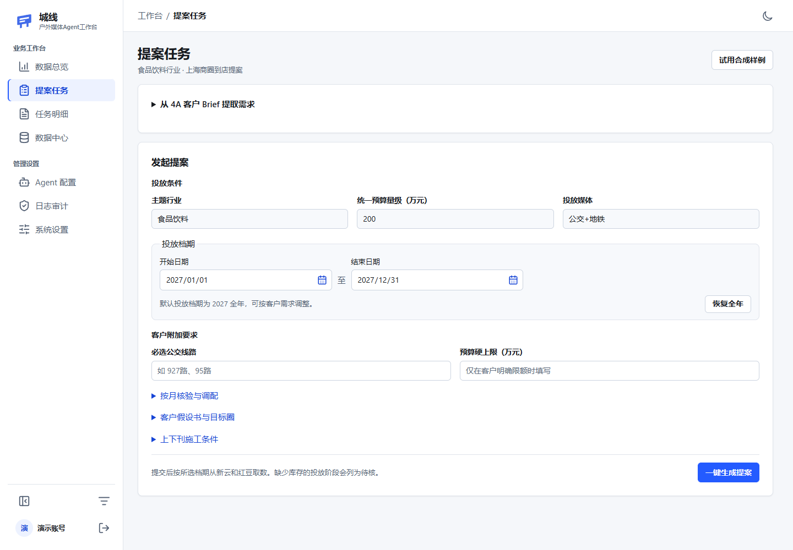
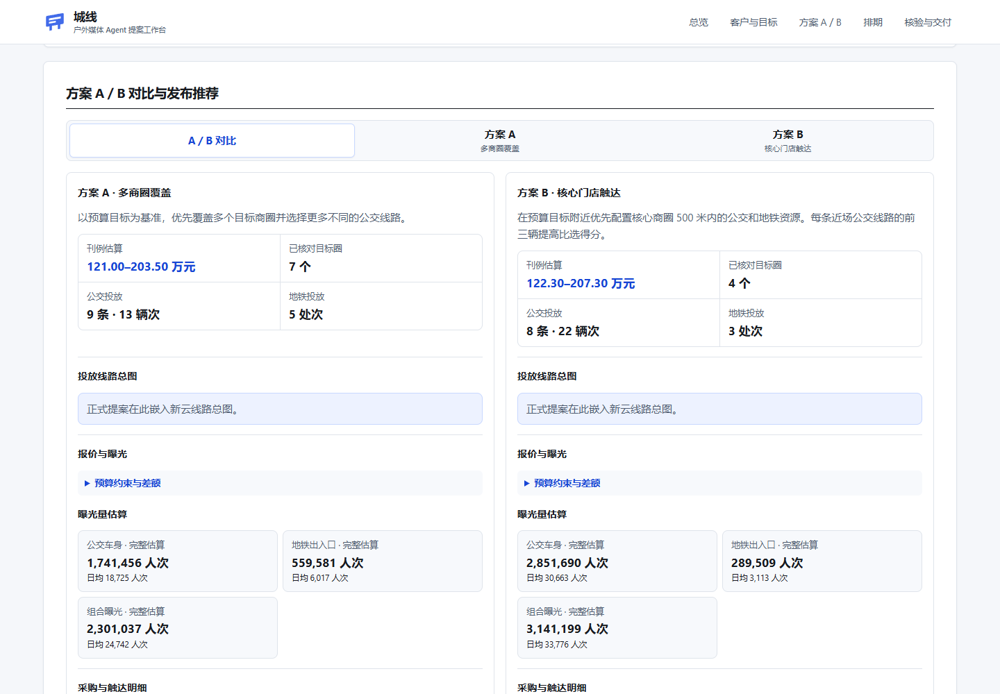

  
  <h1>城线 · 户外媒体 Agent 提案工作台</h1>
  
从客户 Brief 到可核验、可交付的公交车身与地铁出入口广告提案。

  

    
    
    
    
    
  

  
<a href="#快速开始">快速开始</a> · <a href="#演示流程">演示流程</a> · <a href="#agent-工作流">Agent 工作流</a> · <a href="#配置">配置</a>

## 项目简介

户外媒体团队收到客户 Brief 后，往往要跨平台查商圈覆盖、核对档期库存和刊例，再手工整理选址、排期与报价。预算或必选线路一变，采购组合要重新核算，原来的选址依据也容易散落在不同文件里。

城线把需求确认、新云覆盖查询、红豆库存核验、媒介组合求解与人工审核串成同一条流程。每套提案都包含采购清单、线路图、刊例依据与待核事项，可在工作台预览，也可导出为独立 HTML。

## 演示流程

1. 在「提案任务」粘贴脱敏的食品饮料品牌 Brief，确认目标商圈、必选线路、2027 年全年档期及约 200 万元预算。首次体验可直接选择「试用合成样例」。
2. 在任务详情查看取数、组合核算及报告核验进度。授权环境中，按提示登录新云和红豆后继续取数。
3. 打开报告对比 A/B。**A 案扩大商圈覆盖，B 案聚焦核心门店周边。** 两案按同一预算量级、档期和库存计算，可展开线路图、采购数量、刊例及施工核验。
4. 在已锁定数据的任务中，以 100 万元和 500 万元分别重算，查看公交车辆和地铁点位增减、替换以及费用变化。
5. 下载独立 HTML 报告。图表、样式和交互随文件保存，断网后仍可切换方案、查看线路图及采购明细。完成证据核验与人工审核后可导出已确认方案。

## Agent 工作流

| 阶段 | 工作内容 |
| --- | --- |
| 需求确认与取数 | 从 4A Brief 提取目标、媒体、档期及必选线路。人工确认后，查询经授权的新云覆盖和红豆库存。 |
| 需求策略 Agent | 根据已确认的客户目标，判断到访引导、通勤覆盖或品牌认知的策略方向。 |
| 媒介组合 Agent | 根据策略给出资源组合的核算优先级。Rust 依据库存、刊例和必选线路计算 A/B 采购清单、排期与报价。 |
| 报告核验 Agent | 基于实际方案比较及证据提出推荐和复核顺序。系统标注缺失的触达、点位坐标或施工条件，最终方案由人工确认。 |

云端模型接收脱敏的结构化摘要。Brief 原文、库存原表和报价明细留在部署环境。模型不可用或输出未通过校验时，系统按本地规则继续处理，并记录日志。详见 [Agent 协作规范](./Agent协作规范.md)。

## 快速开始

准备支持 Rust Edition 2024 的 [Rust 工具链](https://rust-lang.org/tools/install/)、系统 C 编译工具和 [Node.js 24+](https://nodejs.org/)。正式平台取数使用 Microsoft Edge 与 Playwright Core。

~~~powershell
git clone https://github.com/XinTycd/Cityline-Agent.git
cd Cityline-Agent
npm ci --ignore-scripts
cargo run --locked --manifest-path apps/acceptance-rust/Cargo.toml
~~~

打开 [本机工作台](http://127.0.0.1:3412/) →「试用合成样例」。合成样例无需配置新云、红豆或模型 API Key。

Windows 下可通过项目的 PowerShell 脚本读取本机配置并启动已构建的服务。

~~~powershell
Copy-Item .env.example .env.local
cargo build --locked --manifest-path apps/acceptance-rust/Cargo.toml
.\scripts\start-cityline.ps1 -Executable .\apps\acceptance-rust\target\debug\hackson-acceptance.exe
~~~

## 配置

正式出案使用部署环境的凭据、平台授权与刊例文件。变量见 [.env.example](./.env.example)。

| 配置项 | 说明 |
| --- | --- |
| 服务和 SQLite | 默认监听 `127.0.0.1:3412`，数据写入 `.operations-data/cityline.sqlite`。可用 `ACCEPTANCE_RUST_PORT` 和 `ACCEPTANCE_RUST_DATA` 覆盖。 |
| 媒体刊例 | 将 `CITYLINE_CONTEST_TARIFF` 指向有权使用的 Excel 刊例表。 |
| 新云和红豆 | 在 `.env.local` 配置 `CITYLINE_NEWCLOUD_ORIGIN`、`CITYLINE_REDBEAN_ORIGIN` 及授权资料中的接口路径。新云用于核对覆盖、线路图和触达，红豆用于核对档期库存与点位规格。 |
| 模型接入 | 在「Agent 配置 → 模型接入」选择服务端配置、云端模型、本地模型或本地规则，可测试 Chat Completions 接口。Windows 上可从界面保存 API Key，也可通过环境变量注入。 |
| 登录与授权 | 「系统设置」支持本地管理员登录、OIDC 和飞书登录，也可独立管理红豆库存授权。外部登录需配置 HTTPS 站点地址、回调和允许登录的用户。 |

任务、审计、配置、快照及报告版本存放在 SQLite。预算重算沿用同一批库存和刊例，补证保留原报告并生成复核版本，便于追溯数据来源和方案差异。

## 开发与 CI

~~~powershell
cargo fmt --check --manifest-path apps/acceptance-rust/Cargo.toml
cargo clippy --locked --manifest-path apps/acceptance-rust/Cargo.toml --all-targets -- -D warnings
cargo test --locked --manifest-path apps/acceptance-rust/Cargo.toml
~~~

[GitHub Actions](https://github.com/XinTycd/Cityline-Agent/actions/workflows/ci.yml) 检查 Rust 格式、Clippy、单元测试和媒体提案接口回归。接口回归通过临时 SQLite 数据库运行，使用合成及测试数据，无需平台或模型凭据。

## 项目文档

- [项目需求与联调记录](./PRD.md)
- [Agent 协作规范](./Agent协作规范.md)
- [Agent 提示词与数据交接](./Agent现状与提示词.md)
- [演示与交付说明](./参赛一页纸.md)

欢迎通过 [GitHub Issues](https://github.com/XinTycd/Cityline-Agent/issues) 反馈。提交复现步骤时请使用合成或脱敏数据。

## License

源代码采用 [Apache License 2.0](./LICENSE)。第三方依赖沿用各自许可，企业数据与平台地图按其授权范围使用。
